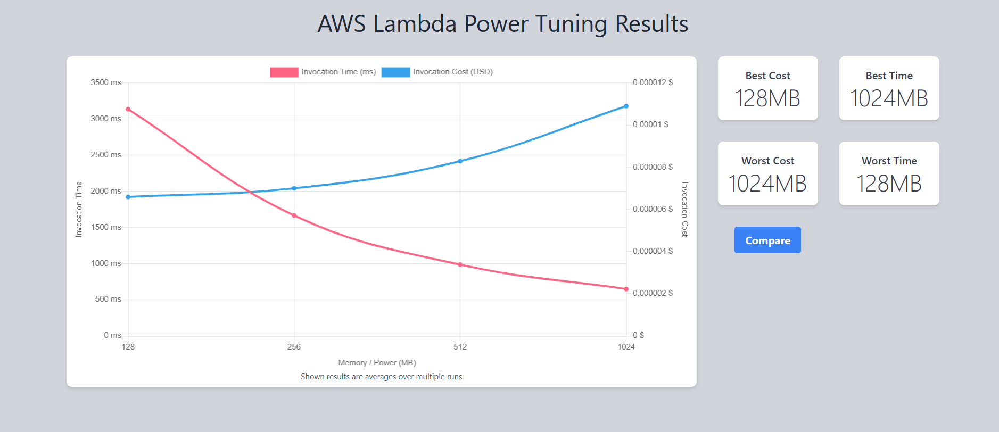

# AWS Lambda Performance Optimization Using Power Tuning and Load Testing

AWS Lambda Power Tuning and Postman performance testing using DynamoDB and API Gateway.

📘 **Overview**

This project demonstrates how AWS Lambda memory tuning can be used to improve application performance while maintaining cost efficiency.

The workload consists of a Python AWS Lambda function that performs CRUD operations against an Amazon DynamoDB table. Performance optimization was conducted using AWS Lambda Power Tuning, and the resulting configuration was validated through Postman load testing.

🧠 **Objective**

To identify the optimal AWS Lambda memory allocation by evaluating the trade-off between execution time and cost, and validating performance improvements through API load testing.

**Architecture**

**1.⚡ Lambda Power Tuning**

**Test Parameters**

| Parameter             | Value                           |
| --------------------- | ------------------------------- |
| Memory Configurations | 128 MB, 256 MB, 512 MB, 1024 MB |
| Invocations per Test  | 10                              |
| Invocation Method     | Parallel                        |
| Optimization Strategy | Cost                            |
| Workload              | DynamoDB Scan                   |

**Key Findings:**

-Increasing memory from 128 MB to 1024 MB reduced execution time from approximately 4500 ms to 700 ms.
-Response latency improved by approximately 84%.
-Cost increased only marginally despite the significant performance gain.
-1024 MB provided the best balance between execution speed and cost efficiency.

**2. Load Testing with Postman**
Created a Postman collection to simulate concurrent requests to the Lambda endpoint.
Used Postman Runner and Monitor to capture metrics:
-Average response time
-Error rate
-Throughput

**128 MB Memory — Results**

**1024 MB Memory — Results**

**🧮 Insights**
- Lambda pricing is proportional to execution time × memory size — faster execution offsets higher memory cost.
- Power tuning helps visualize trade‑offs between cost and performance.
- Load testing validates real‑world behavior under concurrent requests.

**🧰 Tools Used**
- AWS Lambda Power Tuning
- AWS CloudWatch
- Postman
- AWS Console
- Python SDK (boto3) for automation

## Lessons Learned 
- Memory allocation directly impacts CPU allocation in AWS Lambda.
- Higher memory configurations can significantly reduce execution time.
- Optimizing for cost alone may not produce the best user experience.
- Load testing is essential for validating performance tuning decisions.
- Data-driven optimization provides measurable benefits over assumptions.

**🏁 Conclusion**
Using AWS Lambda Power Tuning, I evaluated multiple memory configurations to determine the most cost-effective performance profile for a DynamoDB-backed serverless application.

Testing showed that increasing memory from 128 MB to 1024 MB reduced execution time by approximately 84% while maintaining a similar cost profile. Postman load testing validated the optimization, successfully processing 4,853 requests with a 0% error rate and an average response time of 147 ms.

This project reinforced the importance of measuring, tuning, and validating serverless workloads using real performance data.
